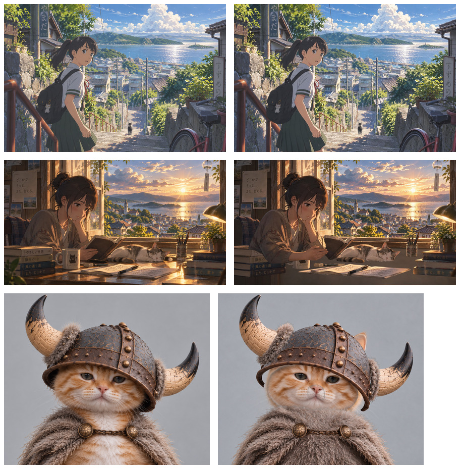

# Awesome Image to Layers

A collection of image-to-layers examples with transparent PNG layers and layered PSD downloads, maintained by [Unmerge](https://unmerge.app/).

Unmerge splits a flat image into named transparent layers, fills in what was hidden behind them, and exports a layered PSD. All examples in this collection were made with Unmerge.

[Try Unmerge](https://unmerge.app/) · [Browse interactive samples](https://unmerge.app/showcase) · [Image to PSD](https://unmerge.app/image-to-psd)

This repository contains 13 sample inputs and their actual AI separation results: 111 raster layers in total. Download the originals, full-canvas PNG layers and layered PSD files to inspect what the model separated, reconstructed or changed. These samples are free to download; generating layers from your own image is a paid service. See the website for current prices.

## Samples

| Sample | Output canvas | Layers | Downloads and demo |
| --- | --- | ---: | --- |
| [Mars magazine cover](samples/mars-cover/) | 832 × 1248 | 4 | [PSD](samples/mars-cover/layers.psd) · [PNG layers](samples/mars-cover/layers/) · [Try it](https://unmerge.app/showcase/mars-cover) |
| [Festival flyer](samples/festival-flyer/) | 832 × 1248 | 6 | [PSD](samples/festival-flyer/layers.psd) · [PNG layers](samples/festival-flyer/layers/) · [Try it](https://unmerge.app/showcase/festival-flyer) |
| [Coffee bag ad](samples/coffee-ad/) | 1248 × 832 | 8 | [PSD](samples/coffee-ad/layers.psd) · [PNG layers](samples/coffee-ad/layers/) · [Try it](https://unmerge.app/showcase/coffee-ad) |
| [Food sticker sheet](samples/sticker-sheet/) | 1024 × 1024 | 10 | [PSD](samples/sticker-sheet/layers.psd) · [PNG layers](samples/sticker-sheet/layers/) · [Try it](https://unmerge.app/showcase/sticker-sheet) |
| [Sneaker sale poster](samples/sale-sneaker/) | 832 × 1248 | 5 | [PSD](samples/sale-sneaker/layers.psd) · [PNG layers](samples/sale-sneaker/layers/) · [Try it](https://unmerge.app/showcase/sale-sneaker) |
| [Missing cat flyer](samples/missing-cat/) | 832 × 1248 | 12 | [PSD](samples/missing-cat/layers.psd) · [PNG layers](samples/missing-cat/layers/) · [Try it](https://unmerge.app/showcase/missing-cat) |
| [Four-product flat lay](samples/flat-lay/) | 1248 × 832 | 5 | [PSD](samples/flat-lay/layers.psd) · [PNG layers](samples/flat-lay/layers/) · [Try it](https://unmerge.app/showcase/flat-lay) |
| [Soda can ad](samples/soda-ad/) | 1024 × 1024 | 11 | [PSD](samples/soda-ad/layers.psd) · [PNG layers](samples/soda-ad/layers/) · [Try it](https://unmerge.app/showcase/soda-ad) |
| [Game item sheet](samples/game-items/) | 1024 × 1024 | 5 | [PSD](samples/game-items/layers.psd) · [PNG layers](samples/game-items/layers/) · [Try it](https://unmerge.app/showcase/game-items) |
| [Rainy street illustration](samples/rainy-street/) | 832 × 1248 | 13 | [PSD](samples/rainy-street/layers.psd) · [PNG layers](samples/rainy-street/layers/) · [Try it](https://unmerge.app/showcase/rainy-street) |
| [Sunlit coastal stairs](samples/coastal-stairs/) | 1248 × 832 | 3 | [PSD](samples/coastal-stairs/layers.psd) · [PNG layers](samples/coastal-stairs/layers/) |
| [Golden hour seaside window](samples/seaside-window/) | 1392 × 784 | 15 | [PSD](samples/seaside-window/layers.psd) · [PNG layers](samples/seaside-window/layers/) |
| [Viking kitten parts](samples/viking-kitten/) | 1152 × 960 | 14 | [PSD](samples/viking-kitten/layers.psd) · [PNG layers](samples/viking-kitten/layers/) |

## Owner-authorized test examples

Coastal stairs, a seaside window and a Viking kitten were processed in test accounts and approved for inclusion by their owner. Each row below shows the input on the left and the reconstructed layer composite on the right. Known changes are described below.

## Download and inspect

Use **Code → Download ZIP** for the complete collection, or open a sample folder and download its PSD using GitHub’s download button. Open the PSD in Photoshop, Photopea or another PSD editor and toggle or move individual layers. Unmerge’s PSD exports have been opened in Photoshop and Photopea; these packaged files have also been decoded and checked against the PNG layer pixels.

Each sample folder contains:

- `original.png`: the flat input image, at its original resolution.
- `layers.psd`: named raster layers at the output canvas resolution.
- `layers/00.png`, `01.png`, …: full-canvas RGBA PNG layers, ordered from bottom to top. Stack them at the same canvas origin; do not apply the source boxes again.
- `composite.png`: the separated layers composited together.
- `preview.webp`: a small input preview.
- `manifest.json`: names, dimensions, order, source boxes and known limitations for that sample.

The root `catalog.json` lists all samples; `SHA256SUMS` contains file checksums. Output resolution can be lower than input resolution. PNGs here use the saved lossless test outputs; the interactive website serves compressed WebP previews.

## What to look for

- **Mars magazine cover:** The parts of the headline hidden behind the helmet were filled in. The ground behind the astronaut is generated.
- **Festival flyer:** The crowd under the sticker was filled in. Stage and crowd details were redrawn and differ from the original.
- **Coffee bag ad:** The beans came back as one group layer. The cup lost most of its cast shadow.
- **Food sticker sheet:** Each sticker is its own layer and keeps its white border.
- **Sneaker sale poster:** The digits under the sneaker were filled in. The sneaker lost its drop shadow, and its toe is still cut off at the edge.
- **Missing cat flyer:** The photo, each text line, and each tab are separate layers. Tab edges were redrawn.
- **Four-product flat lay:** Each product is its own layer. Their cast shadows were not kept.
- **Soda can ad:** The lime wedge in front of the can came back behind it, and the splash was redrawn. Layer order is shown as returned.
- **Game item sheet:** Four items, four layers. The white background kept faint grey marks.
- **Rainy street illustration:** The girl and her umbrella are one layer. Her face and clothing were redrawn, and her reflection stays on the ground when she moves.
- **Sunlit coastal stairs:** The girl and cat are separate layers. Background areas behind them are generated, so fine textures and outlines can differ from the input.
- **Golden hour seaside window:** The scene is split into 15 layers. Tabletop lighting, shadows and small details were redrawn; the composite is not pixel-identical to the input.
- **Viking kitten parts:** Eyes, muzzle, helmet, horns and cloak are separate raster pieces. The face, neck and cloak were redrawn; the output is not a rigged character.

## Limits

A flat image does not contain its original design layers. These are new AI-generated raster layers, not recovered source files. Text is made of pixels, not editable type. Occluded regions are inferred; details, edges, shadows and backgrounds may be redrawn. Results are examples, not a guarantee for another image. The individual manifests preserve known flaws rather than hiding them.

## Provenance and use

The first 10 inputs were AI-generated for Unmerge’s October 2026 model tests. Three additional inputs and their results come from owner-authorized test projects. Layer outputs were produced with Seedream. Cropped result images are placed on a full canvas using the returned bounds; no manual retouching or changes to stacking order are applied. Account details, project identifiers and private download URLs are omitted.

You may download and modify these sample files to evaluate or demonstrate image layering. If you share the samples, include a link to this repository or [Unmerge](https://unmerge.app/). Product names and other marks that may appear in generated images do not imply affiliation or endorsement.
